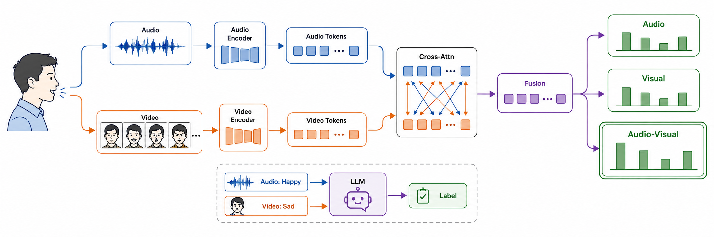

# PAM-VLM: Perception-Aligned Audio-Visual Emotion Recognition

PAM-VLM combines WavLM speech features, EfficientNet facial features,
bidirectional cross-attention, CREMA-D perceptual label distributions, and a
Qwen2.5-0.5B reconciler. The repository contains training and evaluation code,
fixed experiment configurations, lightweight result artifacts, and the IEEE
report.

## Main contributions

- **Clip-level CREMA-D benchmark:** deterministic, emotion-stratified 80/10/10
  split over all 7,442 clips. Clips are disjoint; actors intentionally overlap.
- **Perception-aligned supervision:** voice-only, face-only, and audio-visual
  vote distributions supervise the corresponding model branches.
- **Selective backbone adaptation:** the final two WavLM layers and final two
  EfficientNet stages are fine-tuned with a lower learning rate.
- **Language-model reconciliation:** four learned soft-prefix tokens condition
  frozen Qwen base weights with rank-16 LoRA adapters. Candidate scoring is
  constrained to the six emotion labels.
- **Cross-corpus evaluation:** the CREMA-D-trained model is evaluated zero-shot
  on all 1,056 prepared RAVDESS clips sharing the six target labels.

## Architecture



The primary PAM classifier maps audio and visual sequences into a shared
256-dimensional representation. Bidirectional cross-attention exchanges
context before gated pooling. Audio, video, and fusion heads predict:

`angry`, `disgust`, `fear`, `happy`, `neutral`, and `sad`.

The reconciler concatenates the fusion embedding, audio probabilities, video
probabilities, and audio-video disagreement:

```text
256 fusion + 6 audio + 6 video + 1 disagreement
  -> projector
  -> 4 x 896-dimensional prefix tokens
  -> Qwen2.5-0.5B-Instruct + LoRA
  -> constrained six-label candidate scoring
```

## Evaluation protocols

### Primary CREMA-D track

Protocol ID: `cremad-6class-clip-801010-s42-v2`

| Split | Clips | Actors present |
|---|---:|---:|
| Train | 5,954 | 91 |
| Validation | 744 | 91 |
| Test | 744 | 91 |

This protocol measures clip-level within-corpus recognition. It is **not**
actor-independent and must not be described as unseen-speaker generalization.

### VLM adaptation and transfer

- Mini-CREMA: 780 balanced training clips and 120 validation clips.
- CREMA-D reconciler test: untouched 744-clip primary test partition.
- RAVDESS zero-shot: 1,056 clips from 24 actors; no RAVDESS label is used for
  adaptation, checkpoint selection, routing selection, or prompt tuning.
- Routing thresholds are selected on Mini-CREMA and frozen before both tests.

## Results

### Primary CREMA-D classifier

| Model | Test Macro-F1 | UAR | Accuracy | ECE |
|---|---:|---:|---:|---:|
| Audio-only | 0.720 | 0.720 | 0.719 | 0.057 |
| Video-only | 0.702 | 0.697 | 0.696 | 0.062 |
| Frozen hard-label fusion | 0.849 | 0.845 | 0.847 | **0.038** |
| **PAM high-accuracy** | **0.888** | **0.886** | **0.887** | 0.090 |

The selected model reaches 0.906 validation Macro-F1 and 0.888 held-out test
Macro-F1. These are the primary paper results.

### Qwen reconciliation

| Evaluation | System | Macro-F1 | UAR | Accuracy |
|---|---|---:|---:|---:|
| Mini-CREMA validation (120) | PAM | 0.8750 | 0.8750 | 0.8750 |
|  | Qwen | 0.8919 | 0.8917 | 0.8917 |
|  | PAM+VLM routing | **0.8924** | **0.8917** | **0.8917** |
| CREMA-D test (744) | PAM cache baseline | **0.8870** | **0.8846** | **0.8858** |
|  | Qwen | 0.8750 | 0.8727 | 0.8737 |
|  | PAM+VLM routing | 0.8817 | 0.8791 | 0.8804 |
| RAVDESS zero-shot (1,056) | PAM | **0.5618** | **0.5573** | **0.5634** |
|  | Qwen | 0.5004 | 0.5226 | 0.5312 |
|  | PAM+VLM routing | 0.5071 | 0.5278 | 0.5369 |

The reconciler improves Mini-CREMA validation but degrades both held-out
CREMA-D and cross-corpus RAVDESS results. This is a negative but important
finding: validation-selected confidence/disagreement routing does not
generalize reliably. The primary PAM classifier remains the strongest tested
decision system.

Raw metrics and per-clip predictions are in [`results/`](results/README.md).
The compiled paper is [`report/main.pdf`](report/main.pdf).

## Reproduce

```bash
pip install -r requirements.txt

# Build the fixed CREMA-D clip-level manifests and soft labels.
python scripts/build_manifest.py
python scripts/build_soft_labels.py

# Train and evaluate PAM on SLURM.
sbatch scripts/train_all_augmented.sbatch
sbatch scripts/eval_test.sbatch

# Build cached Mini-CREMA features, train the reconciler, and evaluate.
sbatch scripts/train_vlm_mini_cached.sbatch
sbatch scripts/eval_vlm_cremad_test.sbatch

# Build the RAVDESS manifest and run frozen zero-shot evaluation.
python scripts/build_zeroshot_ravdess_manifest.py
sbatch scripts/zeroshot.sbatch
```

Set `HF_HUB_OFFLINE=1` and `TRANSFORMERS_OFFLINE=1` when using the local
pretrained cache. Checkpoints, pretrained model weights, raw media, and feature
caches are intentionally excluded from Git.

## Repository layout

```text
configs/                 fixed data, model, prompt, and training configurations
scripts/                 manifest, training, evaluation, and SLURM entry points
src/av_mer/data/         splits, disagreement, datasets, and cached VLM features
src/av_mer/models/       encoders, fusion, projector, and Qwen adapter
src/av_mer/evaluation/   metrics, reports, candidate scoring, and routing
src/av_mer/inference/    single-video predictor
tests/                   data, model, evaluation, training, and inference tests
results/                 lightweight metrics, predictions, and figures
report/                  IEEE LaTeX source, references, figures, and final PDF
```

## Evidence boundaries

- The clip-level CREMA-D score benefits from actor overlap and is not an
  actor-independent claim.
- Mini-CREMA is used for reconciler and routing selection; it is validation
  evidence, not a held-out test.
- Published RAVDESS studies use different labels, partitions, and training
  protocols. The zero-shot result is contextual rather than a direct
  leaderboard comparison.
- Multi-seed confirmation and component-wise ablations remain future work.
